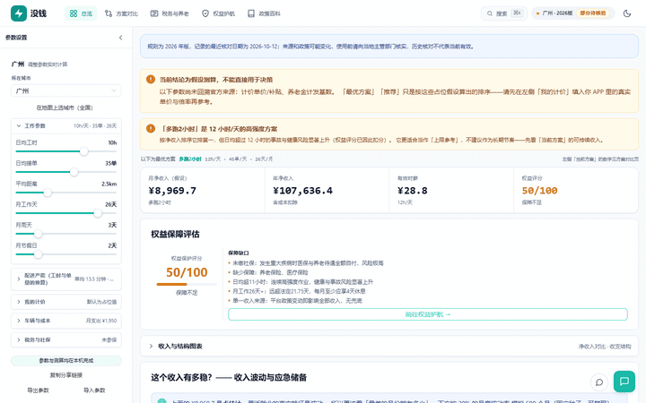

<div align="center">

# No Money

A plain-language guide to rights navigation and benefits for workers in China.

[**English**](README.md) · [简体中文](README.zh-CN.md)



</div>

Work starts with questions nobody explains: how to register for social insurance, what happens when medical insurance lapses, which benefits you can claim, and where to go when an employer stops paying.

No Money turns those questions into a short, ordered list. It tells you what to do first, what you may be owed, and which official channel to use. A calculator sits inside the guide as a tool, not the other way around. The assistant is optional and never invents an amount, document number, or link.

## What it helps with

- **Find the next step.** Pick your city, identity, and situation, or open one of seven ready-made checklists; the first action is always highlighted.
- **Check what you may be owed.** Unpaid wages, injury, dismissal, unused leave, and other common disputes, with the legal basis shown.
- **Understand the numbers.** Net income, effective hourly pay, income tax, and pension contributions, with every assumption visible.
- **Verify the source.** Each policy value is marked official, derived, or unverified. When a value is unverified, the result says so instead of pretending.

## Inside

| Area | What it answers |
|---|---|
| **Start here** | What to do, what to claim, and where to get help |
| **Overview** | Take-home pay and effective hourly wage, with the weakest assumption named |
| **Scenario lab** | What a different work pattern would actually pay |
| **Tax and pension** | Labor income vs sole proprietorship; when contributions break even |
| **Rights** | What you can claim, and under which rule |
| **Policy sources** | Local insurance bases, minimum wage, tax rates, and where each value came from |

## Run it

```bash
npm ci
npm run dev        # web app
```

```bash
npm run cli -- calc --city guangzhou
npm run cli -- compare --cities guangzhou,shenzhen,dongguan
npm run cli -- check
```

Also available as a Windows desktop app, an HTTP API, and an MCP tool for AI assistants. The same calculation kernel powers all of them. See [docs/DEPLOYMENT.md](docs/DEPLOYMENT.md).

## Data, in plain terms

Policy data is not presented as a finished truth. Every field carries a confidence level:

- `official` — traced to a government document and source link
- `derived` — calculated from official figures, not directly published
- `unverified` — no authoritative source yet; shown as an assumption, never as a fact

Platform per-order pay is always unverified because it is a commercial rate, not a published policy. Enter your own rate to get a useful result.

The monthly freshness check fails when a source is older than a year, and opens an issue with the failing cities and fields. It is a maintenance alarm, not a claim that the policy is still current.

## Privacy

No backend, no account, no telemetry, and no third-party JavaScript. The web app works offline once installed. Chat history and API keys stay in the browser unless you explicitly choose to remember them. The assistant only sends the question and calculation context to the endpoint you configure.

## Development

```bash
npm test
npm run test:e2e
npm run typecheck
npm run verify
npm run verify:reality
npm run kb:check
npm run freshness:check
npm run build
npm run doctor
```

Architecture is one-way: `views → components → stores → application → domain`. Every entry point calls the same calculation kernel. See [ARCHITECTURE.md](ARCHITECTURE.md) and [AGENTS.md](AGENTS.md).

## Docs

| Document | Contents |
|---|---|
| [docs/POSITIONING.md](docs/POSITIONING.md) | Product direction and information architecture |
| [docs/REALITY-AND-SCOPE.md](docs/REALITY-AND-SCOPE.md) | Real-world constraints and scope |
| [docs/DEPLOYMENT.md](docs/DEPLOYMENT.md) | Web, Docker, desktop, API, and cache setup |
| [docs/ENGINEERING.md](docs/ENGINEERING.md) | Local checks, CI, and release gates |
| [docs/CONTENT-REVIEW.md](docs/CONTENT-REVIEW.md) | Content cadence, source rules, and reviewer sign-off |
| [docs/VERSIONING.md](docs/VERSIONING.md) | Version and release policy |
| [ROADMAP.md](ROADMAP.md) | What is shipped and what comes next |
| [CONTRIBUTING.md](CONTRIBUTING.md) | How to contribute |
| [SECURITY.md](SECURITY.md) | Security model and reporting |
| [PRIVACY.md](PRIVACY.md) · [TERMS.md](TERMS.md) | Privacy and terms |

## License

[MIT](LICENSE)
