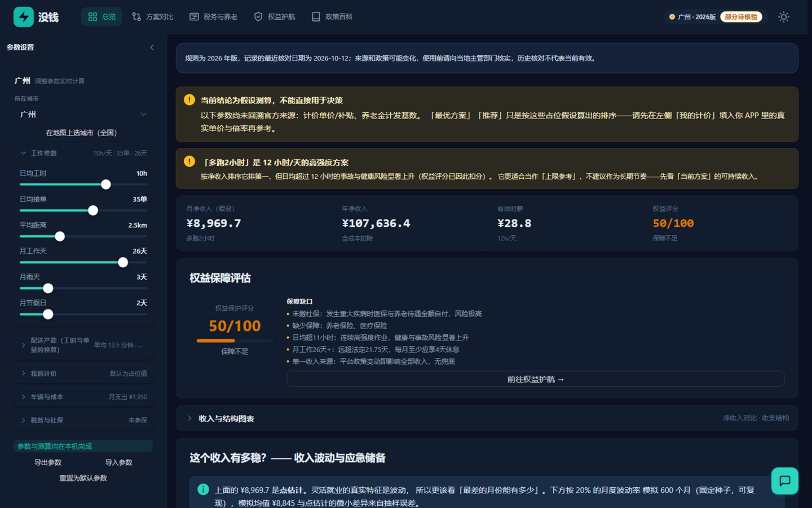
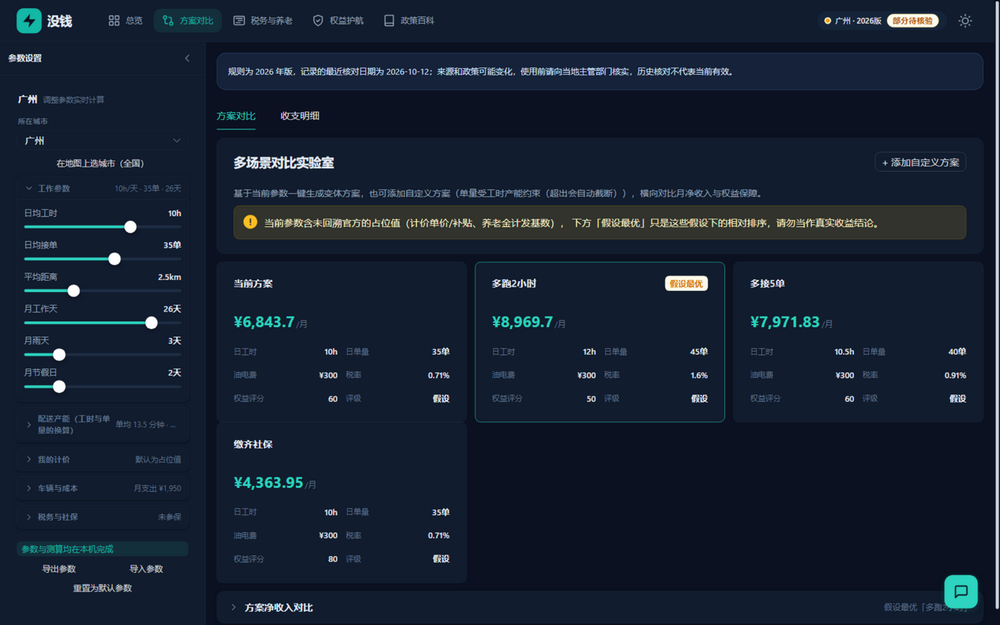
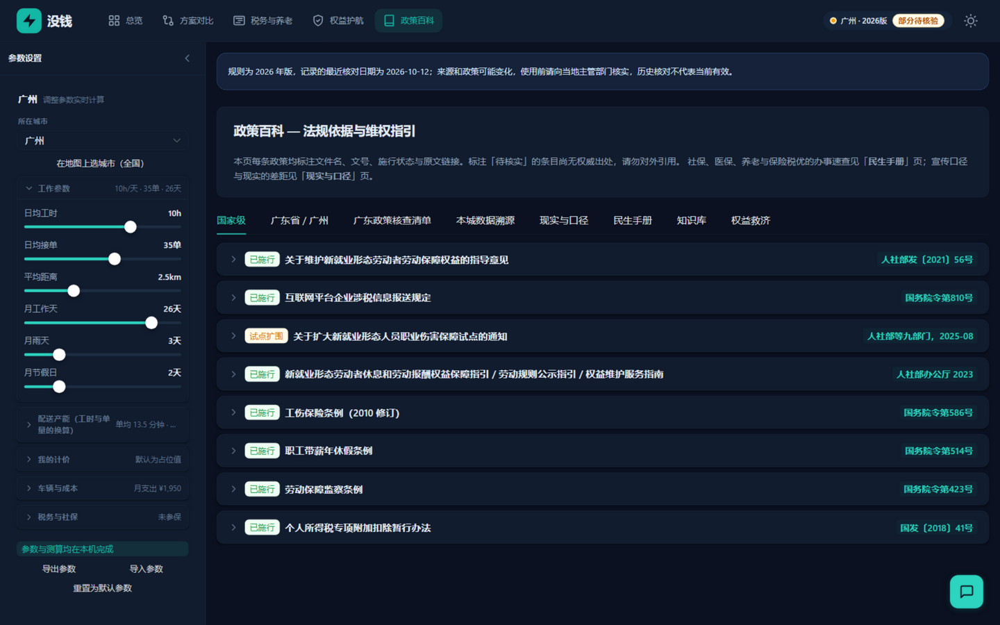

<div align="center">

# No Money

**Know exactly what a gig job actually pays — before you take it.**

Income, tax, social insurance and labor-rights calculator for China's gig workers.
Runs entirely in your browser. No backend, no account, no telemetry.

[](https://github.com/badhope/no-money/actions/workflows/ci.yml)
[](https://github.com/badhope/no-money)
[](docs/DATA.md)
[](#privacy)
[](LICENSE)

**English** · [简体中文](README.zh-CN.md)

</div>

---

## The problem

A delivery rider is told "up to ¥10,000 a month." What that number hides:

- The per-order price is a placeholder, not their real rate
- Social insurance is unpaid, so a hospital stay is 100% out of pocket
- Working 12h/day is the only way the number works — and that carries real injury risk
- Tax depends on whether they register as a sole proprietor, and most calculators get the rate wrong

This tool makes every one of those assumptions visible, and refuses to print a confident number when the input isn't verified.

## What it does

| Module | Answers |
|---|---|
| **Overview** | Net monthly income, effective hourly wage, rights score — with the weakest link named |
| **Scenario lab** | Side-by-side comparison of work patterns; ranks by sustainable income, not raw output |
| **Tax & pension** | Labor remuneration vs sole proprietorship, both tax codes computed separately |
| **Rights** | Compensation for 5 injury/dispute scenarios, split into "claimable now" vs "conditional" |
| **Policy wiki** | 34 cities, every parameter traced to a document number and source link |

## Screenshots

**Overview** — the weakest link is named, not buried. When inputs are unverified the banner says so and "best option" degrades to "assumed best".



**Scenario lab** — compare work patterns horizontally. The 12h/day option ranks first on income and is explicitly flagged as an upper bound, not a recommendation.



**Tax & pension** — labor remuneration and sole proprietorship computed as two separate tax codes. Where the local deemed-profit rate hasn't been verified, the tool refuses to estimate the saving rather than printing a plausible wrong number.


**Rights** — compensation split into "directly claimable" and "conditional", with province-specific legal basis instead of one province's regulation applied nationwide.


**Policy wiki** — every parameter carries a document number, source URL, effective date and verification date.



## Quick start

```bash
npm ci
npm run dev          # http://localhost:3000
npm run tauri:dev    # desktop build (needs Rust toolchain)
npm test             # 1001 tests incl. data-provenance gates
npm run verify       # engine self-check: net-income identity closes
npm run build        # typecheck + production build
```

Node 22+ required.

## The core design principle

> **Show "unverified" rather than present an unverified number as official.**

Every city parameter carries a confidence level:

- `official` — traced to a government document with number and link
- `derived` — computed from official figures, not directly published
- `unverified` — no authoritative source; placeholder only

When a calculation depends on an `unverified` field, the UI downgrades "best option" to "assumed" and lists exactly which fields are unverified. Twenty of the 34 cities have unverified social-insurance bases, and the app says so on screen instead of inventing a number.

Platform per-order pricing is **never** `official` — it's a commercial rule with no cross-platform authority. The only correct path is the user entering their own actual rate.

## Data provenance

| Field | official | derived | unverified |
|---|---|---|---|
| Social insurance base | 14 | 0 | 20 |
| Pension calculation base | 2 | 5 | 27 |
| Minimum wage | 8 | 0 | 26 |
| Platform pricing | 0 | 0 | **34 (all)** |

Enforced by `tests/cities.spec.ts` — adding a city without provenance fails the build.

## Privacy

- No backend. Nothing is uploaded.
- No analytics, no telemetry, no third-party scripts.
- AI assistant is **opt-in**. Your API key stays in memory unless you explicitly tick "remember"; chat history stays in the tab unless you tick "remember history."
- When AI is enabled, only the scenario context and your question go to the endpoint **you** configure.

See [SECURITY.md](SECURITY.md).

## Architecture

```
src/
├── domain/          Pure functions. No Vue, no localStorage, no network.
│   ├── income/      Earnings, capacity, vehicle unit economics, volatility
│   ├── tax/         Annual settlement (table 1), withholding (table 2), sole prop
│   └── benefit/     Contributions, pension actuarial, social vs self-funded
├── application/     Use-case orchestration. No formulas.
├── stores/          Pinia. All I/O lives here.
├── components/      UI
└── views/           Five pages
```

Dependency direction is one-way: `views → components → stores → application → domain`. Money is integer **cents** inside `domain`, yuan at every boundary. Conversion happens in exactly two files.

Full detail: [ARCHITECTURE.md](ARCHITECTURE.md).

## Testing

1001 tests across 42 files:

- **Domain math** — every formula, including boundary and degenerate cases
- **Parity** — the new domain layer is checked numerically against the legacy engine
- **Data gates** — provenance, schema and numeric-range validation for all 34 city files
- **Components** — real mount tests for the document generator, compensation panel, tab routing
- **AI privacy** — default-no-persist, explicit opt-in, deletion failure paths

```bash
npm test
npm run typecheck:test
npm run verify:reality
npm run kb:check
```

## Known limits

- Annual settlement tax basis, **not** platform withholding. If a platform withholds, the real amount uses a different rate table — the UI says so.
- Volatility is a multiplicative model; account bans and injury are not modeled.
- 19 provincial capitals use national-magnitude placeholders, clearly labeled `unverified`.
- This is a decision aid, not tax or legal advice.

## Contributing

See [CONTRIBUTING.md](CONTRIBUTING.md). Bug reports and city-data corrections with a source document are especially welcome.

## License

[MIT](LICENSE)
