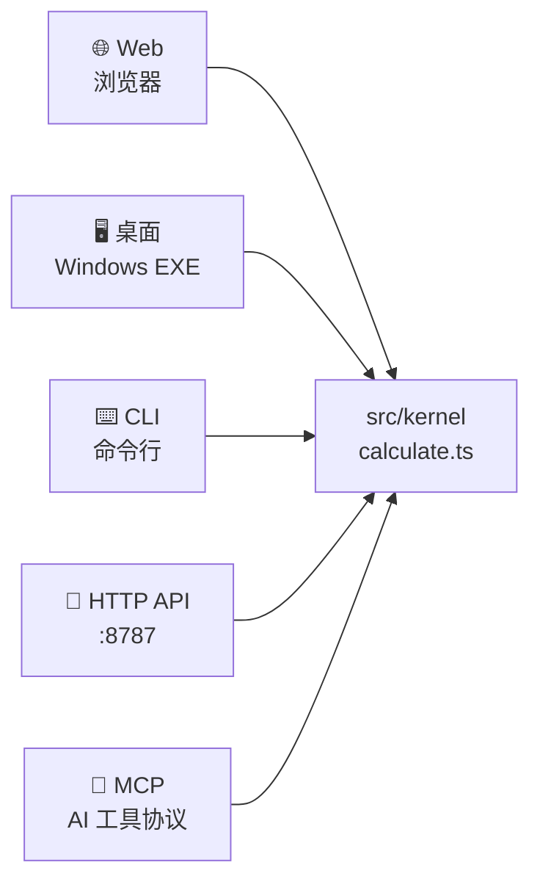
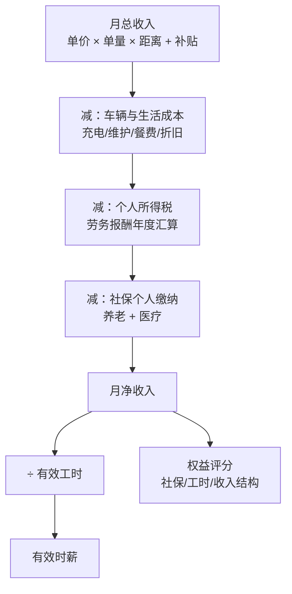
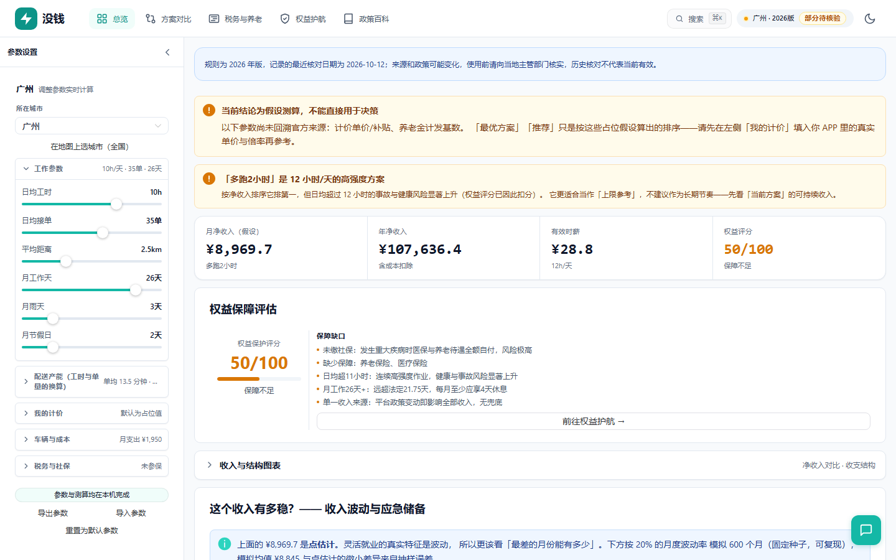
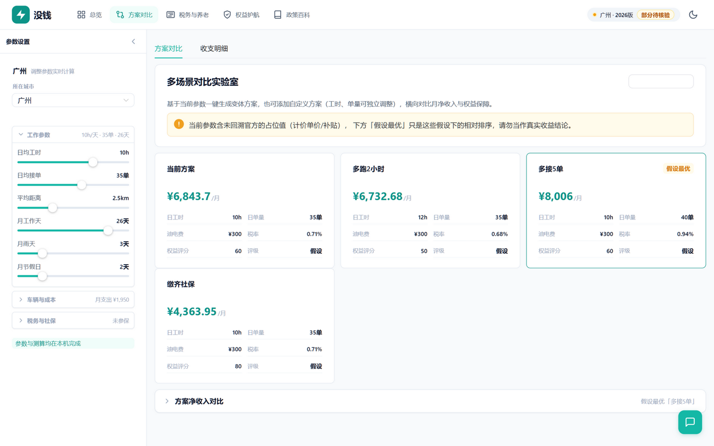
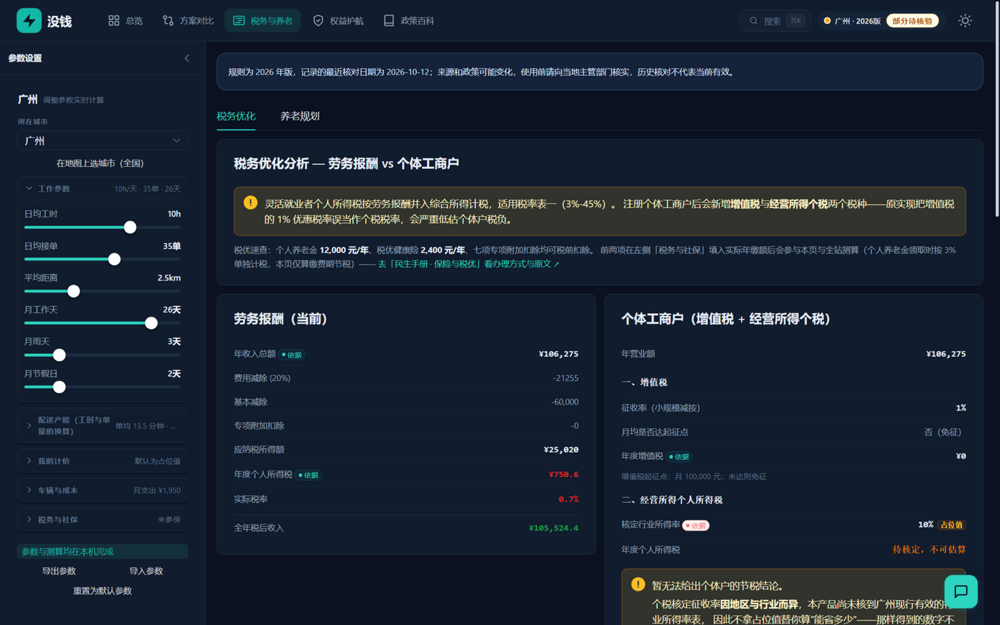
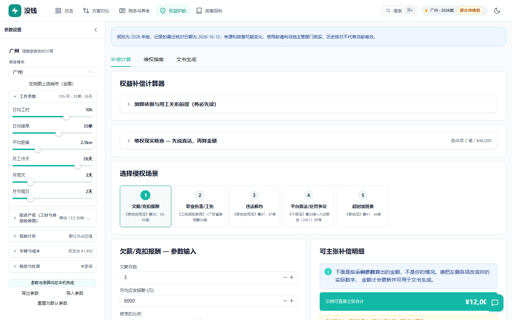
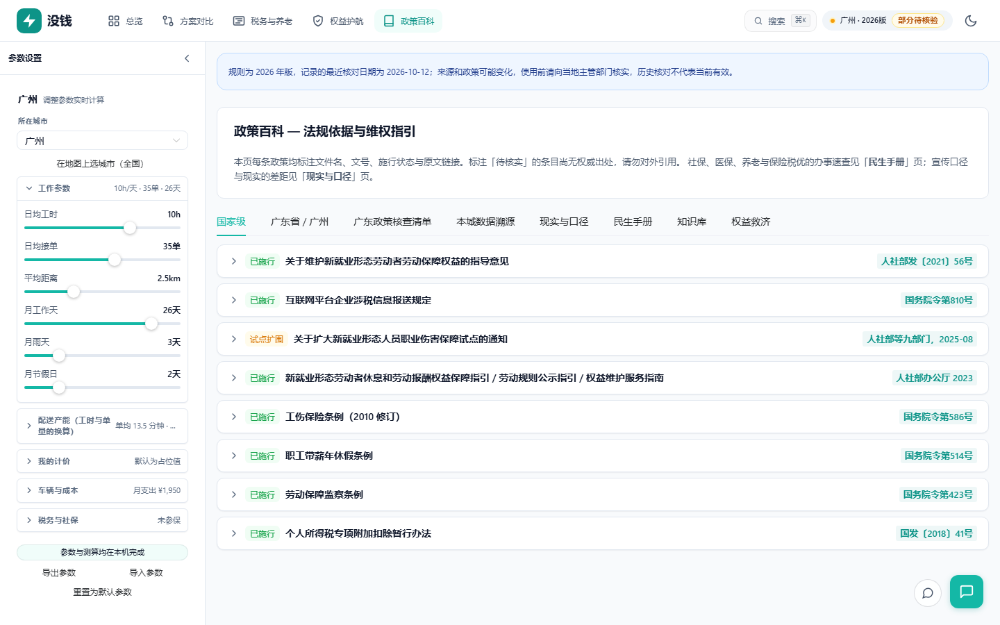
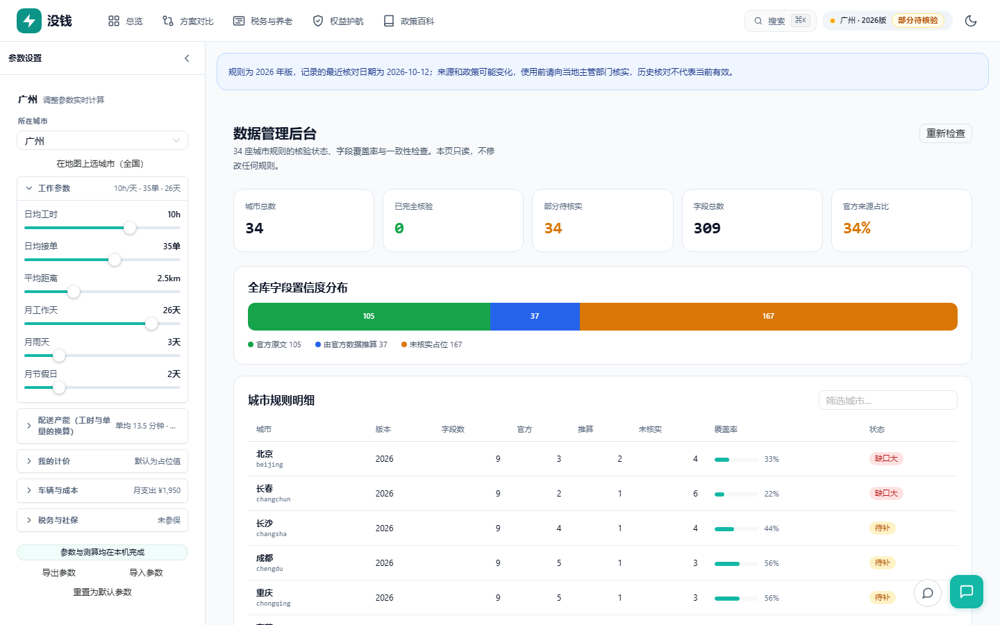
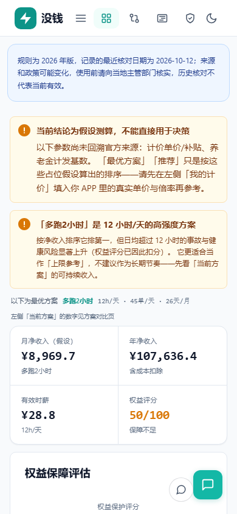
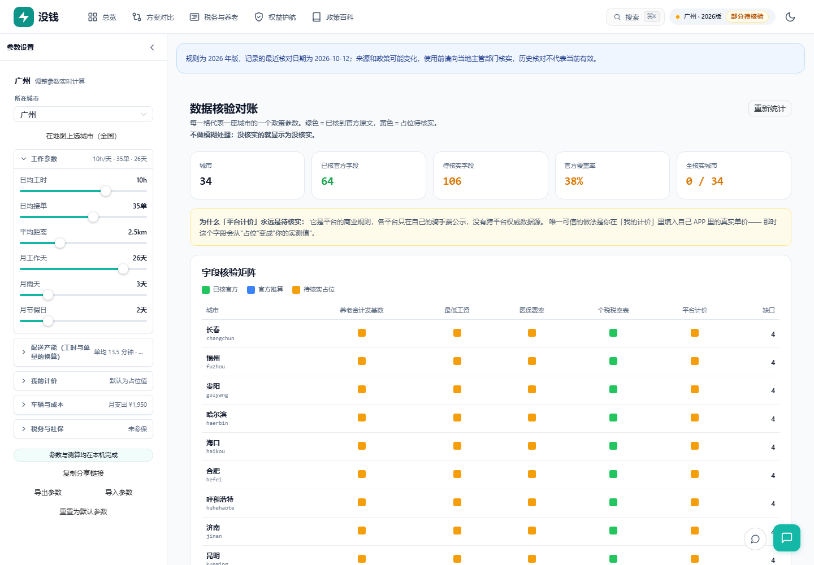

<div align="center">

# 没钱 No Money

**刚出社会，没人告诉你社保怎么交、医保断了怎么办、哪些钱本来可以领。这个平台把「该做什么、能拿什么、去哪办」一条条摊开，每一条都指到官方入口。**

面向中国劳动者的**权益导航与办事平台**。收入 / 个税 / 社保 / 补偿的测算只是其中一件工具，AI 只是辅助。

> 当前版本（3.7.3）在 3.7.2 的新鲜度门禁上补了失败自动开 issue：月度检查失败会开/更新 issue，带报告和本次 run 链接。3.7.2 把数据新鲜度做成可执行门禁：`npm run freshness:check` 检查 34 城规则，任何来源超过 365 天就失败，并配一个月度 CI。3.7.1 把数据溯源页扩成 34 城总览：先看每城官方 / 推算 / 待核验数量和超期数量，再切到具体城市。3.7.0 还在企业职工场景补了 `/employee`：按工资条填税前月薪、个人五险一金和专项附加扣除，算年度个税与月到手，不猜企业缴费比例。其余仍是 3.6.11 的口径与溯源补丁：**60 条权益目录**，其中 **30 条 L2 可办**（材料、步骤、官方入口、时限、坑）、**30 条 L1 可知**（知道有这件事、去哪核验），**10 城深核**（社保、医保、公积金、就业四类本地官方入口）；「我的清单」支持本机时限置顶、txt 导出与打印/另存 PDF；向导首步新增刚入职/刚离职/换城市/被欠薪四个一键入口；结果清单按顺序编号，第 1 件高亮为「先办这个」；清单末尾给出算一算、问 AI、查政策三个下一步；点「问 AI」会自动带入当前城市和第 1 件事；算一算页明确只覆盖灵活就业口径，政策溯源页给出本城参数的新鲜度摘要。完整定位、目标信息架构与迁移计划见 [docs/POSITIONING.md](docs/POSITIONING.md)。

[](https://github.com/badhope/no-money/actions/workflows/ci.yml)
[](https://github.com/badhope/no-money)
[](https://github.com/badhope/no-money)
[](#数据覆盖)
[](#隐私)
[](LICENSE)

[English](README.md) · **简体中文**


</div>

---

## 算力入口

同一套计算内核，四种用法。



| 入口 | 命令 | 适合 |
|---|---|---|
| **Web** | `npm run dev` | 日常使用，全功能界面 |
| **桌面** | **[Windows 下载](https://github.com/badhope/no-money/releases/latest)** — `NoMoney_x.x.x_x64-setup.exe`（安装版）或 `.msi`（企业部署） | 离线使用，无需浏览器 |
| **CLI** | `npm run cli -- calc --city shenzhen` | 批量对比、脚本化 |
| **API** | `npm run api` | 内部系统集成 |
| **MCP** | `npm run mcp` | 让 AI 助手直接算 |
| **PWA** | 浏览器地址栏「安装」 | 装到桌面，断网可用 |

### 30 秒上手

```bash
npm ci
npm run dev        # 打开 http://localhost:3000
```

```bash
# 命令行：广州跑外卖，一个月到手多少
npm run cli -- calc --city guangzhou

# 三个城市横向对比
npm run cli -- compare --cities guangzhou,shenzhen,dongguan

# 34 城规则完整性自检
npm run cli -- check
```

---

## 这个数字是怎么来的



**每一步都可在界面上展开看明细。** 没有黑箱。

---

## 数据覆盖

```
34 座城市 · 全部 31 个省级行政区

官方原文   ███████████████░░░░░░░░░░░░░░░░░░░░░░░   105 项 (34%)
推算得出   ██████░░░░░░░░░░░░░░░░░░░░░░░░░░░░░░░░    37 项 (12%)
未核实占位 ████████████████████████░░░░░░░░░░░░░░   167 项 (54%)
```

每个参数都带来源等级：

| 等级 | 含义 | 界面上 |
|---|---|---|
| `official` | 能追到政府文号与原文链接 | ✅ 已核实 |
| `derived` | 由官方数据推算，非直接公布 | 🔶 推算 |
| `unverified` | 无权威来源，仅占位 | ⚠️ 待核实 |

**当结论依赖未核实字段时，界面会把「最优方案」降级为「假设最优」，并列出具体哪几个字段没核实。**

平台计价单价永远是 `unverified`——它是平台商业规则，没有官方发布渠道。唯一正确的做法是你自己填入 APP 里的真实单价。

---

## 为什么要做这个

一个骑手被告知「月入过万」。这个数字藏了四件事：

- 计价单价是占位值，不是他的真实单价
- 社保没缴，住一次院全部自付
- 只有每天干 12 小时这个数才成立，而这带来真实的工伤风险
- 税取决于是否注册个体户，多数计算器把税率算错

**这个工具把这四项假设全部摊开；输入没有核实来源时，不给出确定结论。**

---

## 界面

<table>
<tr>
<td width="50%"></td>
<td width="50%"></td>
</tr>
<tr>
<td><b>总览</b> — 净收入、有效时薪、权益评分，点名最薄弱的一环</td>
<td><b>方案对比</b> — 横向比较多套工作节奏，按可持续收入排序</td>
</tr>
<tr>
<td></td>
<td></td>
</tr>
<tr>
<td><b>税务与养老</b> — 劳务报酬与个体工商户两套税制分开算</td>
<td><b>权益护航</b> — 五类纠纷的补偿金额与法律依据</td>
</tr>
<tr>
<td></td>
<td></td>
</tr>
<tr>
<td><b>政策百科</b> — 34 城参数逐条溯源</td>
<td><b>数据后台</b> — 覆盖率统计与一致性检查</td>
</tr>
<tr>
<td></td>
<td></td>
</tr>
<tr>
<td><b>移动端</b> — 390px 布局，触控目标 ≥ 24px</td>
<td><b>深色主题</b> — 可选，刷新后保持</td>
</tr>
<tr>
<td colspan="2"></td>
</tr>
<tr>
<td colspan="2"><b>数据核验</b> — 34 城 × 5 类字段逐项标注。34% 已核到官方原文，页面如实说明而不是藏起来。</td>
</tr>
</table>

---

## 当前版本的六个模块（权益导航 P0 已上线）

> 3.6.0 的实现顺序：先办事，再算钱；3.6.5 把省市办事入口收成一个解析器；未深核城市回退省级，不编市级链接。3.6.6 把目录补到 60 条，并给「我的清单」加本机时限置顶、txt 导出和打印/另存 PDF；3.6.7 再加四个常见情况的一键入口；3.6.8 把结果清单排序，第 1 件先办；3.6.9 再接上算一算、问 AI、查政策三个下一步；3.6.10 让「问 AI」自动带入当前城市和第 1 件事；3.6.11 把「只算灵活就业」和本城数据新鲜度写在页面上，减少误读；3.7.0 新增企业职工工资条页 `/employee`，按年度综合所得算到手，并把骑手参数侧栏从该页移除；3.7.1 再把政策溯源页扩成 34 城总览，读取失败的城不补 0。六段导航仍未重排，居民/新毕业生口径仍未接，见 [docs/POSITIONING.md](docs/POSITIONING.md) 与 [ROADMAP.md](ROADMAP.md)。

| 模块 | 回答什么 |
|---|---|
| **办事入口** | 我该做什么、能拿什么、社保医保怎么办、遇到麻烦怎么办；3 步生成 3–7 条清单；可加入我的清单、标记已办 |
| **总览** | 月净收入、有效时薪、权益评分，最薄弱的一环是什么 |
| **方案对比** | 换一套工作节奏能多赚多少，值不值 |
| **税务与养老** | 劳务报酬 vs 个体户，哪套更省；社保缴多少年划算 |
| **权益护航** | 被欠薪/工伤/违法解约能拿多少，依据哪条法 |
| **政策百科** | 这座城市的社保基数、最低工资、税率是多少，出处在哪 |

---

## 隐私

```
✅ 无后端        ✅ 无账号        ✅ 无埋点
✅ 无第三方脚本  ✅ 数据不出设备  ✅ 可完全离线
```

**可离线**：安装为 PWA 后，断网也能打开并完成测算。实测断网后页面完整可用。

AI 助手是**可选**的：
- API Key 默认只在内存，勾选「记住」才落盘
- 对话历史默认只存当前标签页
- 只发送测算上下文与你填的问题，发往**你自己配置**的端点
- 非本机端点强制 HTTPS，拒绝 URL 内嵌凭据

详见 [SECURITY.md](SECURITY.md)。

---

## 开发

```bash
npm ci
npm run dev            # Web 开发服务器
npm test               # 1159 项单元测试
npm run test:e2e       # 114 项浏览器测试（构建 + 跑）
npm run typecheck      # 类型检查
npm run verify         # 引擎恒等式自检
npm run verify:reality # 数据现实性核查
npm run kb:check       # 知识库同步检查
npm run build          # 生产构建
npm run tauri:build    # Windows 安装包
```

**架构**：`views → components → stores → application → domain`，单向依赖。
所有入口共用 `src/kernel/calculate.ts`，绝不各自重算。

完整开发约定见 [AGENTS.md](AGENTS.md) 与 [ARCHITECTURE.md](ARCHITECTURE.md)。

---

## 已知边界

| 边界 | 说明 |
|---|---|
| 税制口径 | 按**年度汇算**算，不是平台预扣预缴。若平台代扣，实际到手用另一套税率表 |
| 波动模型 | 乘性模型，未建模封号与工伤等尾部事件 |
| 省级代表值 | 19 个省会用全国量级占位，已标 `unverified` |
| 定位 | 决策辅助工具，不构成税务或法律意见 |

---

## 文档

| 文档 | 内容 |
|---|---|
| [AGENTS.md](AGENTS.md) | AI 编码代理的开发约定 |
| [ARCHITECTURE.md](ARCHITECTURE.md) | 分层与数据流 |
| [ROADMAP.md](ROADMAP.md) | 路线图与优先级 |
| [SECURITY.md](SECURITY.md) | 安全模型与漏洞上报 |
| [CONTRIBUTING.md](CONTRIBUTING.md) | 贡献指南 |
| [docs/VERSIONING.md](docs/VERSIONING.md) | 版本规范 |
| [docs/DEPLOYMENT.md](docs/DEPLOYMENT.md) | 部署、缓存头与 Docker |
| [docs/RESEARCH.md](docs/RESEARCH.md) | 18 个同类项目调研与采纳记录 |
| [PRIVACY.md](PRIVACY.md) | 隐私政策 |
| [TERMS.md](TERMS.md) | 服务条款 |
| [THIRD-PARTY-NOTICES.md](THIRD-PARTY-NOTICES.md) | 第三方许可 |

## 许可

[MIT](LICENSE)
