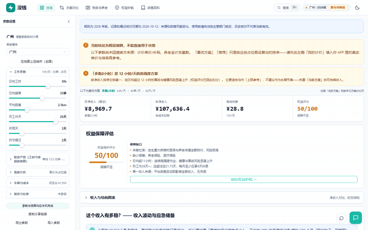

<div align="center">

# 没钱 No Money

给中国劳动者的一份说人话的权益与办事指南。

[English](README.md) · [**简体中文**](README.zh-CN.md)



</div>

刚出社会，很多事没人讲清楚：社保怎么登记、医保断了会怎样、哪些钱本来可以领、老板不发工资该找谁。

没钱 No Money 把这些事排成一份有先后的清单：先做什么、可能能拿什么、去哪个官方入口办。算钱是清单里的工具，不是整个产品；AI 只是辅助，不编金额、文号或链接。

## 它能帮你什么

- **找到下一步。** 选城市、身份和处境，得到一份短清单，第 1 件事直接标出来。
- **看能主张什么。** 欠薪、工伤、辞退、未休年假等常见纠纷，列出可主张的项目和依据。
- **把账算明白。** 净收入、有效时薪、个税、养老缴费，每一步假设都摊开。
- **核对来源。** 每个政策数值都标官方、推算或待核验；没核到的就明说，不装作已核实。

## 里面有什么

| 区域 | 回答什么 |
|---|---|
| **办事入口** | 该做什么、能领什么、去哪办 |
| **总览** | 到手收入、有效时薪，以及最薄弱的假设 |
| **方案对比** | 换一种干活方式，实际能多拿多少 |
| **税务与养老** | 劳务报酬 vs 个体户；缴多少年才回本 |
| **权益护航** | 能主张什么，依据是哪一条 |
| **政策溯源** | 本城社保基数、最低工资、税率，以及每个数值的来源 |

## 运行

```bash
npm ci
npm run dev        # 网页版
```

```bash
npm run cli -- calc --city guangzhou
npm run cli -- compare --cities guangzhou,shenzhen,dongguan
npm run cli -- check
```

也有 Windows 桌面版、HTTP API 和给 AI 助手用的 MCP 工具。四个入口共用同一个计算内核，详见 [docs/DEPLOYMENT.md](docs/DEPLOYMENT.md)。

## 数据说明

政策数据不假装是最终真相。每个字段都带置信度：

- `official` — 能追到政府文件和来源链接
- `derived` — 由官方数字推算，不是直接公布
- `unverified` — 还没有权威来源，只作为假设展示，不当事实

平台按单计价永远是待核验，因为它是商业价格，不是公开政策。填自己的真实单价，结果才有意义。

月度新鲜度检查会在任一来源超过一年时失败，并自动开 issue 列出城市和字段。它是维护警报，不是“政策仍然有效”的证明。

## 隐私

没有后端、没有账号、没有遥测、没有第三方 JavaScript。网页版装成 PWA 后可以离线打开。聊天记录和 API Key 默认只留在浏览器里，只有你主动勾选“记住”才会保存。AI 只把问题和计算上下文发给你自己配置的接口。

## 开发

```bash
npm test
npm run test:e2e
npm run typecheck
npm run verify
npm run verify:reality
npm run kb:check
npm run freshness:check
npm run build
npm run doctor
```

架构是单向的：`views → components → stores → application → domain`。所有入口都调用同一个计算内核。详见 [ARCHITECTURE.md](ARCHITECTURE.md) 和 [AGENTS.md](AGENTS.md)。

## 文档

| 文档 | 内容 |
|---|---|
| [docs/POSITIONING.md](docs/POSITIONING.md) | 产品定位与信息架构 |
| [docs/REALITY-AND-SCOPE.md](docs/REALITY-AND-SCOPE.md) | 现实约束与范围 |
| [docs/DEPLOYMENT.md](docs/DEPLOYMENT.md) | 网页、Docker、桌面、API 与缓存 |
| [docs/ENGINEERING.md](docs/ENGINEERING.md) | 本地检查、CI 与发布门禁 |
| [docs/VERSIONING.md](docs/VERSIONING.md) | 版本与发布规则 |
| [ROADMAP.md](ROADMAP.md) | 已交付内容与下一步 |
| [CONTRIBUTING.zh-CN.md](CONTRIBUTING.zh-CN.md) | 贡献指南 |
| [SECURITY.zh-CN.md](SECURITY.zh-CN.md) | 安全模型与报告方式 |
| [PRIVACY.md](PRIVACY.md) · [TERMS.md](TERMS.md) | 隐私政策与服务条款 |

## License

[MIT](LICENSE)
